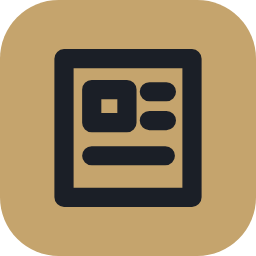

# Meinungsmache für Home Assistant



Die Nachrichten von [meinungsmache.de](https://meinungsmache.de) in Home Assistant: Feeds auswählen, die neuesten Artikel auf dem Dashboard zeigen und Automationen auslösen, etwa bei einem exklusiven Artikel, einer Meldung zu Donald Trump oder zur Wirtschaft.

Projektseite mit Beschreibung und Beispielen: [poc.deutschkaemer.info/meinungsmache-home-assistant](https://poc.deutschkaemer.info/meinungsmache-home-assistant/)

*English version below.*

## Was die Integration macht

- **28 Feeds zur Wahl:** alle Artikel, Startseite, Ressorts (Politik, Wirtschaft, Umwelt …), Parteien, Personen und Länder. Gewählt wird bei der Einrichtung, ändern lässt sich die Auswahl jederzeit über „Konfigurieren“.
- **Je Feed ein Gerät** mit drei Entitäten:

  | Entität | Inhalt |
  |---|---|
  | `sensor.meinungsmache_<feed>_neuester_artikel` | Titel des neuesten Artikels, Bild als Entitätsbild; Attribute: Link, Zeitpunkt, Anrisstext, Autorin/Autor, `exklusiv`, `eigen` und die Liste `eintraege` für die Karte |
  | `sensor.meinungsmache_<feed>_zuletzt_erschienen` | Zeitpunkt des neuesten Artikels |
  | `event.meinungsmache_<feed>_neuer_artikel` | löst je neuem Artikel aus, Art `artikel`, `eigener_artikel` oder `exklusiv` |

  `<feed>` ist die Kennung mit Unterstrich, also `all`, `politik`, `donald_trump`, `europaeische_union` …
- **Ereignis `meinungsmache_neuer_artikel`** auf dem Bus, einmal je neuem Artikel, auch wenn er in mehreren gewählten Feeds zugleich erscheint.
- **Dashboard-Karte** `custom:meinungsmache-card`, wird mit der Integration geladen.
- **Zwei Automations-Vorlagen** (Blueprints), werden bei der Einrichtung unter `blueprints/automation/meinungsmache/` abgelegt.

Abgerufen werden nur die öffentlichen RSS-Feeds, standardmäßig alle 15 Minuten (einstellbar ab 5 Minuten; die Seite hält die Feeds 5 Minuten im Zwischenspeicher). Beim ersten Abruf eines Feeds wird nichts gemeldet, nur gemerkt. Nach einem Neustart zählen nur Artikel der letzten Stunde als neu, damit nicht alles Verpasste auf einmal auslöst.

## Installation

**Über den Marketplace** (bis zur Aufnahme als benutzerdefiniertes Repository): Einstellungen → Marketplace → ⋮ → Benutzerdefinierte Repositories → `https://github.com/rony-x2/meinungsmache-home-assistant`, Typ „Integration“. Danach „Meinungsmache“ installieren und Home Assistant neu starten.

**Von Hand:** den Ordner `custom_components/meinungsmache` nach `/config/custom_components/` kopieren und neu starten. Im Terminal-Add-on geht das in einem Schritt:

```bash
cd /config && mkdir -p custom_components && \
  curl -fsSL https://github.com/rony-x2/meinungsmache-home-assistant/archive/refs/heads/main.tar.gz \
  | tar xz --strip-components=2 -C custom_components meinungsmache-home-assistant-main/custom_components/meinungsmache && \
  ha core restart
```

Dann Einstellungen → Geräte & Dienste → Integration hinzufügen → „Meinungsmache“.

## Dashboard-Karte

Im Dashboard „Karte hinzufügen“ → „Meinungsmache“ wählen; alles lässt sich im Editor einstellen. In YAML:

```yaml
type: custom:meinungsmache-card
entities:
  - sensor.meinungsmache_all_neuester_artikel
  - sensor.meinungsmache_wirtschaft_neuester_artikel
  - sensor.meinungsmache_donald_trump_neuester_artikel
anzahl: 5          # Artikel je Feed (höchstens so viele, wie in der Integration eingestellt)
bilder: true       # Vorschaubilder
teaser: false      # Anrisstext
nur_eigene: false  # nur Artikel der Redaktion
titel: Nachrichten # Überschrift (optional)
```

Mehrere Feeds erscheinen als Reiter. Ein Tipp auf einen Artikel öffnet ihn auf meinungsmache.de. Die Bilder lädt der Browser direkt von meinungsmache.de; wer das nicht möchte, stellt `bilder: false` ein.

## Automationen

### Mit den Vorlagen

Einstellungen → Automationen → Blueprints:

- **„Meinungsmache: Neuer Artikel – Benachrichtigung“** schickt Titel, Anrisstext und Bild an die Companion-App; ein Tipp öffnet den Artikel.
- **„Meinungsmache: Neuer Artikel – Aktionen“** führt beliebige Aktionen aus; `{{ titel }}`, `{{ link }}`, `{{ teaser }}`, `{{ bild }}`, `{{ autor }}` und `{{ feed_name }}` stehen bereit.

Beide filtern nach Feeds, nach Art (alle, eigene, exklusiv) und auf Wunsch nach Stichwörtern in Titel und Anrisstext. Taucht ein Artikel in mehreren gewählten Feeds auf, löst die Automation nur einmal aus.

| Ziel | Feeds | Art | Stichwörter |
|---|---|---|---|
| Exklusiver Artikel erschienen | Alle Artikel | Nur exklusive | – |
| Meldung zu Trump | Donald Trump, USA | Alle | – (oder Feed „Alle Artikel“ mit „Trump“) |
| Meldung zur Wirtschaft | Wirtschaft | Alle | – |
| Neuer Artikel generell | Alle Artikel | Alle | – |

Die Vorlagen lassen sich auch direkt importieren:

[](https://my.home-assistant.io/redirect/blueprint_import/?blueprint_url=https%3A%2F%2Fgithub.com%2Frony-x2%2Fmeinungsmache-home-assistant%2Fblob%2Fmain%2Fcustom_components%2Fmeinungsmache%2Fblueprints%2Fbenachrichtigung.yaml)
[](https://my.home-assistant.io/redirect/blueprint_import/?blueprint_url=https%3A%2F%2Fgithub.com%2Frony-x2%2Fmeinungsmache-home-assistant%2Fblob%2Fmain%2Fcustom_components%2Fmeinungsmache%2Fblueprints%2Fneuer_artikel.yaml)

### Von Hand

Mit der Event-Entität (im Automations-Editor: Auslöser „Entität“ → „Neuer Artikel“):

```yaml
triggers:
  - trigger: state
    entity_id: event.meinungsmache_all_neuer_artikel
    not_from: [unavailable, unknown]
conditions:
  - condition: state
    entity_id: event.meinungsmache_all_neuer_artikel
    attribute: event_type
    state: exklusiv
actions:
  - action: persistent_notification.create
    data:
      title: "{{ trigger.to_state.attributes.titel }}"
      message: "{{ trigger.to_state.attributes.link }}"
```

Oder mit dem Ereignis auf dem Bus:

```yaml
triggers:
  - trigger: event
    event_type: meinungsmache_neuer_artikel
conditions:
  - "{{ 'wirtschaft' in trigger.event.data.feeds }}"
actions:
  - action: notify.notify
    data:
      title: "{{ trigger.event.data.titel }}"
      message: "{{ trigger.event.data.teaser }}"
```

Daten des Ereignisses: `titel`, `link`, `veroeffentlicht` (ISO-Zeit), `teaser`, `bild`, `autor`, `exklusiv`, `eigen`, `feed`, `feed_name`, `feeds` (Feeds, in denen der Artikel jetzt neu ist) und `frueher` (Feeds, in denen er schon gemeldet war, falls er erst später in einem weiteren Feed auftaucht).

## Hinweise

- „Eigene Artikel“ erkennt die Integration daran, dass der Feed eine Autorin oder einen Autor nennt, „exklusiv“ am Titel („EXKLUSIV: …“).
- Die Inhalte und alle Rechte daran liegen bei meinungsmache.de. Die Integration zeigt Titel, einen kurzen Anrisstext und verlinkt auf den Artikel.
- Fehler und Wünsche bitte als [Issue](https://github.com/rony-x2/meinungsmache-home-assistant/issues).

---

## English

Brings the news from [meinungsmache.de](https://meinungsmache.de) (German-language) into Home Assistant: pick feeds, show the latest articles on your dashboard and trigger automations, e.g. for exclusive articles or news about a topic.

- **28 feeds** (all articles, front page, sections, parties, people, countries), selectable during setup and via “Configure”.
- **One device per feed** with a *latest article* sensor (title, image, link, list of entries for the card), a *last published* timestamp sensor and a *new article* event entity (types `artikel`, `eigener_artikel`, `exklusiv`).
- **Bus event `meinungsmache_neuer_artikel`**, fired once per new article even if it appears in several selected feeds.
- **Dashboard card** `custom:meinungsmache-card`, loaded automatically; configurable in the card editor.
- **Two blueprints** (notification to the companion app, generic actions), copied to `blueprints/automation/meinungsmache/` on setup, filtering by feed, type and keywords.

Install through the Marketplace as a custom repository (`https://github.com/rony-x2/meinungsmache-home-assistant`, type “Integration”) or copy `custom_components/meinungsmache` to `/config/custom_components/`, restart, then add the integration under Settings → Devices & services. The card loads images directly from meinungsmache.de; set `bilder: false` to avoid that. Content and all rights belong to meinungsmache.de.

## Lizenz

MIT, siehe [LICENSE](LICENSE). © 2026 Dennis Deutschkämer
